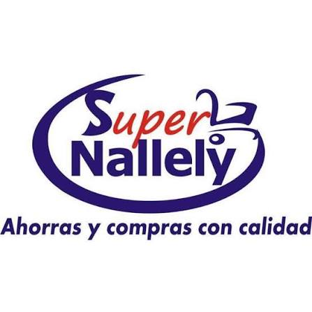

<div align="center">



# superShop

### Plataforma de gestión para tiendas de abarrotes, conveniencia y supermercados

[](https://react.dev)
[](https://www.typescriptlang.org)
[](https://vitejs.dev)
[](https://tailwindcss.com)
[](https://nodejs.org)
[](https://expressjs.com)
[](https://github.com/WiseLibs/better-sqlite3)
[](https://web.dev/progressive-web-apps/)

[](#-roadmap)
[](#-autor)

</div>

---

## 📖 ¿Qué es superShop?

**superShop** es una plataforma para la **gestión integral de tiendas de abarrotes, conveniencia y supermercados**. Está pensada como un conjunto de **módulos independientes** que comparten una misma base técnica y de autenticación.

El **primer módulo implementado es el de Satisfacción del Cliente**: captura encuestas desde un **kiosko táctil** en tienda y las analiza desde un **panel administrativo** con estadísticas y exportación de reportes.

> **Estado:** el módulo de Encuestas está **completo y usable**. La arquitectura ya está preparada para incorporar nuevos módulos (inventario, punto de venta, reportes, etc.).

---

## ✨ Características (Módulo Encuestas)

- 🖥️ **Kiosko "Mi encuesta"** — flujo guiado (selección de tienda/caja/cajero → preguntas → calificación con caritas → agradecimiento), con cooldown anti-duplicados.
- 📶 **Offline-first** — las encuestas se guardan en una *outbox* local y se sincronizan al recuperar conexión (idempotencia por `client_uuid`).
- 🧩 **Encuesta configurable** — preguntas y opciones (áreas, gusto, disgusto) con opciones exclusivas ("Todo bien" / "Todo me gustó").
- 📊 **Panel de administración** — panel principal, respuestas con filtros y **estadísticas** con gráficas (tendencia, promedios, distribución).
- 📤 **Exportación** a **Excel (.xlsx)** y **PDF**.
- 🏬 **Catálogos** — gestión de tiendas, cajas y cajeros(as).
- 👥 **Usuarios y roles** — `admin` y `cashier` con permisos diferenciados.
- ⚙️ **Ajustes de la tienda** — nombre, eslogan y logo.
- 📱 **PWA instalable** — con service worker y soporte de modo offline.
- 🔐 **Seguridad** — sesiones con expiración, `helmet` + CSP, `rate-limiting`, CORS restringible e invalidación de sesiones al cambiar rol/contraseña.

---

## 🧱 Stack tecnológico

### Frontend
| Tecnología | Uso |
|---|---|
| **React 19** + **TypeScript** | UI y tipado |
| **Vite 8** | Build y dev server (code-splitting por ruta) |
| **Tailwind CSS 4** | Estilos |
| **React Router 7** | Enrutado |
| **Recharts** | Gráficas de estadísticas |
| **lucide-react** | Iconografía |
| **jspdf** + **SheetJS (xlsx)** | Exportación PDF / Excel |
| **vite-plugin-pwa** | PWA / offline |

### Backend
| Tecnología | Uso |
|---|---|
| **Node.js** + **Express 5** | API REST |
| **better-sqlite3** | Base de datos SQLite (WAL) |
| **bcryptjs** | Hash de contraseñas |
| **helmet** / **compression** / **cors** / **express-rate-limit** | Seguridad y rendimiento |

---

## 🏗️ Arquitectura

```
┌────────────────────────┐        HTTP/REST        ┌────────────────────────┐
│   Frontend (SPA PWA)   │ ──────────────────────► │   Backend (API REST)   │
│   React + Vite         │ ◄────────────────────── │   Express + SQLite     │
└────────────────────────┘        /api/*           └────────────────────────┘
          ▲                                                     │
          └────────── servido como estáticos ───────────────────┘
                     (el backend sirve frontend/dist)
```

- **Backend:** monolito modular (rutas por dominio: `auth`, `public`, `admin`, `surveys`, `stats`, `settings`).
- **Frontend:** SPA organizada **por features/módulos** (`modules/*`), con UI compartida en `components/` e infraestructura en `lib/`.
- **Despliegue simple:** el backend sirve la SPA ya compilada en el mismo origen, por lo que no requiere CORS en producción.

---

## 📁 Estructura del proyecto

```
superShop/
├── backend/
│   ├── scripts/gen-certs.ps1      # genera certificados HTTPS locales
│   └── src/
│       ├── index.js               # servidor Express (helmet, cors, rate-limit…)
│       ├── db.js                  # esquema y migraciones SQLite
│       ├── middleware.js          # sesión / autorización
│       ├── questions.js           # definición de la encuesta
│       └── routes/                # auth · public · admin · surveys · stats · settings
└── frontend/
    ├── assets/                    # iconos PWA y logo
    └── src/
        ├── app/                   # shell de la app (App + AdminLayout)
        ├── components/            # UI compartida (Modal, Select, Pagination…)
        ├── lib/                   # api, auth, offline, export, format…
        └── modules/               # features: auth, catalog, kiosk, panel, surveys, settings
```

---

## 🚀 Puesta en marcha

### Requisitos
- **Node.js** 20+ (recomendado 24)
- **npm**

### 1) Backend
```bash
cd backend
npm install
npm run dev      # http://localhost:3001
```
> La base de datos SQLite se crea y se siembra automáticamente en `backend/data/nallely.db`.

### 2) Frontend
```bash
cd frontend
npm install
npm run dev      # http://localhost:5173  (proxy /api → :3001)
```

### Build de producción
```bash
cd frontend
npm run build    # genera frontend/dist
```
Luego el backend sirve `frontend/dist` automáticamente desde la raíz.

### 🔑 Credenciales demo
| Rol | Correo | Contraseña |
|---|---|---|
| Administrador | `admin@nallely.com` | `admin123` |
| Cajero(a) | `cajero@nallely.com` | `cajero123` |

> ⚠️ Credenciales de **demostración** generadas por el *seed*. Cámbialas antes de usar el sistema en producción.

---

## 🔐 Variables de entorno (backend)

| Variable | Por defecto | Descripción |
|---|---|---|
| `PORT` | `3001` | Puerto HTTP |
| `HTTPS_PORT` | `3443` | Puerto HTTPS (si hay certificados en `backend/certs/`) |
| `NODE_ENV` | — | `production` activa la redirección a HTTPS y CORS cerrado |
| `TRUST_PROXY` | `false` | `true` si corre detrás de un proxy inverso |
| `ALLOWED_ORIGINS` | — | Lista separada por comas de orígenes permitidos (CORS) |
| `SESSION_TTL_HOURS` | `24` | Duración de la sesión |

---

## 🔌 API (resumen)

| Método | Ruta | Acceso |
|---|---|---|
| `POST` | `/api/auth/login` | Público (rate-limited) |
| `GET` | `/api/auth/me` | Autenticado |
| `POST` | `/api/auth/logout` | Autenticado |
| `GET` | `/api/branches` · `/api/branches/:id/registers` · `/api/branches/:id/cashiers` | Público |
| `GET` | `/api/settings` | Público |
| `PUT` | `/api/admin/settings` | Admin |
| `POST` | `/api/surveys/batch` | Público (rate-limited) |
| `GET` | `/api/stats` · `/api/activity` | Admin / Cajero |
| `GET` | `/api/admin/surveys` | Admin / Cajero |
| `GET/POST/PUT/DELETE` | `/api/admin/{branches,registers,cashiers,users}` | Admin |
| `PUT` | `/api/admin/password` | Autenticado |
| `GET` | `/api/health` | Público |

---

## 🛡️ Seguridad

- Contraseñas con **bcrypt** y sesiones por *bearer token* con **expiración** (`SESSION_TTL_HOURS`).
- **Invalidación automática** de sesiones al cambiar contraseña, rol o desactivar un usuario.
- **Helmet** con Content-Security-Policy y protección de *clickjacking* (`frame-ancestors 'none'`).
- **Rate-limiting** en login y envío de encuestas.
- **CORS** cerrado por defecto en producción (solo mismo origen o lista explícita).

---

## 🗺️ Roadmap

- [x] **Módulo 1 — Satisfacción del cliente** (encuestas + panel + estadísticas)
- [ ] **Módulo 2 — Inventario** y control de stock
- [ ] **Módulo 3 — Punto de venta (POS)**
- [ ] **Módulo 4 — Reportes y analítica de negocio**
- [ ] Multi-sucursal y sincronización central
- [ ] Tests automatizados (unit + e2e)

---

## 👨‍💻 Autor

**Edgar León Archuleta**
[](https://github.com/EdgarLeonArchuleta19)

<div align="center">

⭐ Si te resulta útil, deja una estrella en el repo.

</div>
